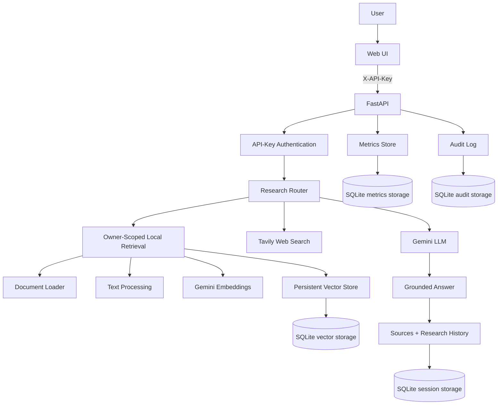

# AI Research & Document Agent

An experimental local research workspace that combines document-grounded retrieval with optional web research. It ingests a small local document collection, retrieves relevant evidence, generates a grounded Gemini answer, preserves source metadata, and stores document, session, and metrics data locally in SQLite.

## 1. Project Overview

Research questions often require searching both an organization's own documents and current external sources. This project demonstrates that workflow as a Python application:

1. Documents are loaded from TXT, PDF, and DOCX files.
2. Text is cleaned, chunked, embedded, and persisted in a local vector store.
3. A query is embedded and compared with stored vectors using cosine similarity.
4. The research router uses local evidence first and calls Tavily when local relevance is below a configurable threshold.
5. Gemini generates an answer from the labeled local and web context.
6. Sources, sessions, research history, latency, and evaluation metrics are persisted locally.

This is a portfolio and learning project, not a production-ready deployment.

## 2. Key Features

- Local document ingestion for `.txt`, `.pdf`, and `.docx` files.
- Text cleaning and configurable overlapping chunking.
- Gemini document and query embeddings using `gemini-embedding-001`.
- Cosine-similarity retrieval over a local persistent vector store.
- SQLite-backed document metadata and JSON-encoded embedding vectors.
- SHA-256 duplicate document detection and stable document IDs.
- Retrieval-Augmented Generation with Gemini answer generation.
- Local-document and Tavily web research routing.
- Combined local and web source citations with source metadata.
- Persistent research sessions and question/answer history.
- Server-side API-key authentication: clients send a secret key, and the owner identity is resolved on the server.
- Per-owner document and session isolation enforced in SQL before ranking and before any AI generation.
- Owner-scoped retrieval so unauthorized document content is never sent to Gemini.
- Append-only audit log for uploads, research, deletions, and denied access.
- Document upload, indexing, listing, and deletion APIs.
- FastAPI backend with automatic Swagger documentation.
- Plain HTML/CSS/JavaScript browser UI.
- Persistent request metrics for latency, sources, retrieval, citations, and errors.
- A 10-question deterministic baseline RAG evaluation dataset and report script.
- Automated tests covering ingestion, retrieval, routing, persistence, sessions, authentication, ownership isolation, migrations, audit, API behavior, metrics, and evaluation.

## 3. Architecture



## 4. RAG Pipeline

```text
document
  -> extraction
  -> cleaning
  -> chunking
  -> Gemini embeddings
  -> persistent vector storage
  -> query embedding
  -> cosine-similarity search
  -> retrieved context
  -> Gemini answer generation
  -> grounded answer with sources
```

`document_loader.py` extracts text from supported file types. `text_processor.py` removes unnecessary whitespace and creates overlapping word chunks. `embeddings.py` creates document and query vectors. `PersistentVectorStore` stores vectors and metadata in SQLite, then ranks chunks by cosine similarity. The router labels retrieved records as local or web evidence before passing them to the existing answer generator.

## 5. Web Research Pipeline

`ResearchRouter` calculates the best local retrieval score. When that score is at least `RAG_RELEVANCE_THRESHOLD` (default `0.75`), the answer uses local document evidence. When local evidence is empty or below the threshold, `WebSearcher` calls the Tavily search API. Local chunks and web results can both be sent to Gemini when both are available.

The answer prompt instructs Gemini to use only supplied context, distinguish local documents from web sources, cite web URLs and local chunk IDs, and state when the available evidence is insufficient. It also treats the retrieved context as untrusted data and instructs the model to ignore any instructions embedded in documents or web results. The router does not perform planning or autonomous agent behavior.

## 6. Technology Stack

- Python 3.14 environment used for validation.
- FastAPI and Uvicorn for the HTTP API and development server.
- Pydantic for request and response validation.
- Google GenAI Python SDK (`google-genai`) for embeddings and Gemini generation.
- Tavily Search API accessed through `requests`.
- SQLite from the Python standard library for vector metadata, sessions, and metrics.
- JSON-encoded Python lists for persisted embedding vectors.
- `pypdf` for PDF extraction and `python-docx` for DOCX extraction.
- `python-dotenv` for environment configuration.
- Plain HTML, CSS, and JavaScript for the browser UI.
- `pytest` for automated tests.
- `time.perf_counter()` and Python `logging` for request observability.

## 7. Project Structure

```text
.
├── app/
│   ├── api.py
│   ├── main.py
│   ├── ingestion/
│   │   ├── document_loader.py
│   │   └── document_manager.py
│   ├── processing/
│   │   └── text_processor.py
│   ├── retrieval/
│   │   ├── embeddings.py
│   │   ├── persistent_vector_store.py
│   │   └── vector_store.py
│   ├── research/
│   │   ├── research_router.py
│   │   ├── session_manager.py
│   │   └── web_search.py
│   ├── generation/
│   │   └── answer_generator.py
│   ├── observability/
│   │   ├── metrics.py
│   │   ├── audit.py
│   │   └── models.py
│   ├── security/
│   │   └── auth.py          # API-key authentication and owner resolution
│   ├── evaluation/
│   │   ├── dataset.py
│   │   └── evaluator.py
│   └── web/
│       ├── index.html
│       ├── app.js
│       └── styles.css
├── data/
│   ├── documents/
│   ├── storage/              # generated SQLite session and metrics files
│   └── vector_store/          # generated SQLite vector files
├── scripts/
│   └── evaluate_rag.py
├── tests/
├── .env.example
├── .gitignore
├── README.md
├── requirements.txt
├── requirements-dev.txt        # runtime requirements plus pytest, for development and tests
└── .venv/                    # local virtual environment, not committed
```

## 8. API Endpoints

| Method | Path | Purpose |
| --- | --- | --- |
| GET | `/` | Service status and UI location. |
| GET | `/health` | Health/status response. |
| GET | `/docs` | FastAPI Swagger UI. |
| GET | `/openapi.json` | OpenAPI schema generated by FastAPI. |
| GET | `/ui` | Serves the browser application. |
| GET | `/ui/assets/{file}` | Serves frontend CSS and JavaScript assets. |
| POST | `/research` | Researches a question through the hybrid router. |
| POST | `/documents/upload` | Validates, indexes, and persists a TXT/PDF/DOCX upload. |
| GET | `/documents` | Lists the authenticated owner's indexed documents. |
| DELETE | `/documents/{document_id}` | Deletes an owned document, its chunks, and its stored file. |
| POST | `/sessions` | Creates a persistent research session. |
| GET | `/sessions` | Lists the authenticated owner's research sessions. |
| GET | `/sessions/{session_id}` | Returns an owned session and its research history. |
| DELETE | `/sessions/{session_id}` | Deletes an owned session and its history. |
| POST | `/sessions/{session_id}/research` | Runs research and saves the result to an owned session. |
| GET | `/metrics` | Returns aggregate persisted request metrics. |
| GET | `/audit` | Returns the authenticated owner's audit events. |
| POST | `/evaluation/run` | Runs the local deterministic evaluation dataset. |

The implemented session route is `/sessions` plural; `/session` is not an API route. All routes except `/`, `/health`, `/docs`, `/openapi.json`, `/ui`, and `/ui/assets/*` require a valid `X-API-Key` header and return `401` without one. Sessions, documents, and audit listings are scoped to the owner resolved from that key.

## 9. Installation

macOS/Linux:

```bash
python -m venv .venv
source .venv/bin/activate
pip install -r requirements.txt
```

For development and tests, install the development requirements instead (they include the runtime requirements plus `pytest`):

```bash
pip install -r requirements-dev.txt
```

## 10. Environment Variables

Copy `.env.example` to `.env` and replace only the placeholders on your local machine:

```env
GEMINI_API_KEY=your_gemini_api_key_here
TAVILY_API_KEY=your_tavily_api_key_here
API_KEYS=owner-a:change-me-key-a,owner-b:change-me-key-b
LEGACY_OWNER_ID=legacy
RAG_RELEVANCE_THRESHOLD=0.75
VECTOR_STORE_PATH=data/vector_store
SESSION_STORE_PATH=data/storage/research_sessions.db
METRICS_STORE_PATH=data/storage/metrics.db
AUDIT_STORE_PATH=data/storage/audit.db
```

`GEMINI_API_KEY` is used for embeddings and Gemini answer generation. `TAVILY_API_KEY` is used for web search. Both are read server-side and are never sent to the browser. `API_KEYS` is a comma-separated list of `owner-id:secret-key` entries; clients authenticate by sending one of these secrets in the `X-API-Key` header, and the server resolves the owner identity itself. A secret that maps to two different owners is treated as ambiguous and rejected. `LEGACY_OWNER_ID` is the owner assigned to documents and sessions created before ownership existed (default `legacy`). The path and threshold variables have defaults in the application.

**DO NOT COMMIT `.env` OR REAL API KEYS.** The `X-API-Key` value is entered by the user in the browser UI and stored in `localStorage` (see the security section); treat it as a bearer secret and avoid shared machines. The Gemini and Tavily server credentials never reach the browser.

## 11. Running Locally

Start the FastAPI application:

```bash
uvicorn app.api:app --reload
```

Open the browser UI at [http://127.0.0.1:8000/ui](http://127.0.0.1:8000/ui). Swagger is available at [http://127.0.0.1:8000/docs](http://127.0.0.1:8000/docs).

The earlier command-line demonstration remains available with:

```bash
python -m app.main
```

## 12. Testing

Install the development requirements first (runtime requirements plus `pytest`):

```bash
pip install -r requirements-dev.txt
```

Run the complete suite with:

```bash
python -m pytest
```

The latest verified run collected and passed **93 tests**. Tests mock Gemini, Tavily, and external research calls where appropriate; persistence, migration, authentication, and ownership tests use isolated temporary databases and synthetic documents.

That run used Python **3.14.6** with `pytest` 9.1.1 in a local `.venv`. This is the environment that produced the reported 93-test result; it is not necessarily the only supported Python version, and other versions have not been verified here.

## 13. Example Workflow

### Local document workflow

```text
Upload document
  -> validate and index
  -> clean and chunk
  -> create embeddings
  -> persist vectors
  -> ask research question
  -> retrieve relevant chunks
  -> generate grounded answer
  -> display sources
  -> save research session history
```

### Web-assisted workflow

```text
User question
  -> query embedding and local similarity search
  -> compare best local score with threshold
  -> use local evidence, or add Tavily results
  -> label local and web context
  -> Gemini answer with citations
  -> persist session result and request metrics
```

## 14. Screenshots

Screenshots are not currently committed. Add portfolio screenshots later at these relative paths:

```text
docs/screenshots/main-ui.png
docs/screenshots/research-results.png
docs/screenshots/document-upload.png
docs/screenshots/system-metrics.png
```

Suggested captures are the main UI, a cited research result, document upload feedback, and the System Metrics/RAG Evaluation panel.

## 15. Security

- Gemini and Tavily credentials are read from environment variables.
- `.env` is listed in `.gitignore`; generated SQLite databases, WAL files, and per-owner uploaded document directories are ignored.
- Clients authenticate with an `X-API-Key` secret. The owner identity is resolved on the server from `API_KEYS`; a client-supplied user ID or arbitrary header is never trusted. Keys are compared in constant time with `hmac.compare_digest`. Missing, malformed, or ambiguous configuration (`API_KEYS` unset, entries without a colon, or one secret mapped to two owners) results in `401` rather than an open or ambiguous identity.
- Documents and research sessions are associated with an owner and every list, read, query, and delete operation is scoped to that owner.
- Retrieval filters by owner in SQL before similarity ranking, so unauthorized chunks are never scored, returned, or sent to an AI provider.
- Cross-owner reads and deletes return `404` rather than revealing whether another owner's resource exists.
- Per-owner dependency checks reject missing or invalid credentials with `401` before any resource is touched.
- Uploads are restricted to TXT, PDF, and DOCX extensions, use a sanitized filename basename, and are stored under a per-owner directory.
- Deleting a document removes its stored file first and then its metadata and chunks; if the file cannot be removed the delete fails with `503` and the indexed document is left intact, so a deleted document is never resurrected by startup re-indexing.
- If a file cannot be written after a new document is indexed, the upload is rolled back so no orphaned index entry remains.
- SQL statements use parameterized values and multi-row writes run in transactions.
- The answer prompt treats retrieved document and web content as untrusted data and instructs the model to ignore any instructions embedded in it.
- Sources returned with an answer are exactly the evidence retrieved, and each carries a citation index and chunk ID; insufficient evidence is stated explicitly instead of fabricated.
- An append-only audit log records event ID, actor, action, resource ID, outcome, and timestamp. It never records passwords, API keys, tokens, or full document contents.
- Access-denied audit writes are throttled by a thread-safe, in-process mechanism, so repeated unauthenticated requests cannot flood the audit store.
- That throttle limits audit-event writes only; it is not a general request-rate limiter, and it is per-process (each worker keeps its own state).
- Malformed or ambiguous `API_KEYS` configuration is surfaced through safe diagnostic logging that reports only counts and the configuration variable name, never secret values or owner IDs.
- Error responses avoid exposing stack traces to browser users.

## 16. Limitations

- Authentication uses static, operator-configured shared secrets, not OAuth, per-user passwords, or token rotation.
- The browser UI stores the `X-API-Key` in `localStorage`, so it persists unencrypted and is readable by any script on the same origin (for example, via XSS). This is a convenience for local use only and is not production-safe; a real deployment would use short-lived, `HttpOnly`-cookie or header-based tokens.
- Per-owner upload directories are named after a sanitized owner id; owner ids should stay within `[A-Za-z0-9._-]` so that startup re-indexing maps files back to the same owner.
- The vector store is local SQLite with JSON-encoded vectors and performs an in-process scan; it is not designed for large-scale distributed retrieval.
- Ownership isolates documents and sessions, but request metrics are stored as a single global aggregate and are not yet per-owner.
- Documents and sessions created before ownership existed are assigned to the `LEGACY_OWNER_ID` owner and are not visible to newly configured owners unless that owner is mapped to a key.
- There is no rate limiting, TLS termination, or cloud deployment configuration.
- Gemini and Tavily availability, quotas, latency, and source quality affect results.
- Research sessions store result snapshots but do not provide a full conversational memory model.
- Evaluation is a small deterministic baseline. Keyword coverage and source matching do not establish semantic correctness or factual faithfulness.
- There is no streaming response path, background job queue, or production migration strategy.

## 17. Future Improvements

The following are planned possibilities, not completed features:

- PostgreSQL and `pgvector` for scalable vector and metadata storage.
- Redis for caching, queues, or rate limiting.
- OAuth/OIDC or password-based accounts with token rotation and per-user metrics.
- Docker packaging, CI/CD, and cloud deployment.
- Streaming Gemini responses and background evaluation jobs.
- Larger, versioned evaluation datasets with human labels and stronger semantic metrics.
- Structured tracing and dashboards beyond the current SQLite metrics and audit stores.
- Request quotas, retries, circuit breakers, and provider failover.

## 18. Resume Project Description

Built a Python FastAPI research agent that ingests multi-format documents, performs persistent embedding-based retrieval, routes low-confidence questions to Tavily web search, and generates source-grounded Gemini answers. Added server-side API-key authentication with per-owner document and session isolation enforced before retrieval, an append-only audit log, safe ownership migrations, and deterministic RAG evaluation with a 93-test automated suite.
